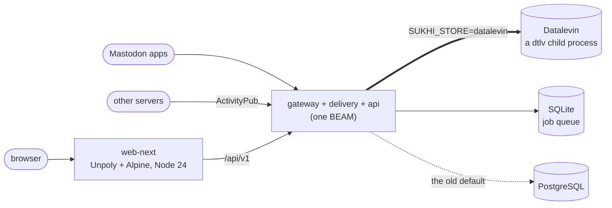

<!-- SPDX-License-Identifier: AGPL-3.0-or-later -->
# Developing: run it, test it, build it

> **Intent:** someone running sukhi on their own machine for the first time should
> be able to take the first step without getting lost.
> **Reader's problem (hypothesis):** "what do I need to install?", "which parts are
> current and which are old?"
>
> To run your own server for people, start at [`OPERATIONS.ja.md`](OPERATIONS.ja.md) instead.
> This page is for trying it and changing it. The table of contents is [`README.md`](README.md).

Welcome. If you have come to try sukhi on your own machine, or to change something in it, this page is the way in.
You do not need to read everything. Take the first step, and see if it moves.

> [!NOTE]
> **What is current** (as of 2026-11): the store is **Datalevin**, the pages are **web-next**, and production runs as containers under **Podman** (Quadlet).
> The Postgres store and the old SvelteKit `web/` are **kept running only**: no new features go there.

## The shape of it



* **Thick arrow**: where the data lives now. The `dtlv` binary runs as a child of the BEAM, over a pipe. One database, one writer.
* **Dotted arrow**: the default when `SUKHI_STORE` is not set, kept so that nothing breaks. [`DATALEVIN.md`](DATALEVIN.md) says what differs.
* The whole design is in [`ARCHITECTURE.md`](ARCHITECTURE.md) (long; read it when you want to, not before).

## Pick a way in

| You want to… | Go to |
|---|---|
| see the **pages** change, with nothing else running | [Working on the UI](#working-on-the-ui-web-next) |
| run the **whole server** on your machine | [Run it locally](#run-it-locally-no-docker) |
| build it all in containers | [Everything, in Docker](#run-it-locally-everything-in-docker) |
| run your **own** server for people | not here: [`OPERATIONS.ja.md`](OPERATIONS.ja.md) (Japanese) |

## Working on the UI (web-next)

The lightest first step. It starts with a **fake gateway**, so no real one is needed, and it starts signed in.
Node 24 and pnpm.

```bash
cd web-next
pnpm install
pnpm run dev:mock   # http://localhost:5174
pnpm test
```

> [!TIP]
> `make ui-lab` is a bench for putting looks side by side before building them ([`web-next/ui-lab/README.md`](../web-next/ui-lab/README.md)).
> All of web-next's environment variables are in [`web-next/README.md`](../web-next/README.md) (Japanese).

## Run it locally (no Docker)

```bash
make dev        # http://localhost:4000
```

`make dev` starts an embedded Postgres (PGlite: Postgres compiled to WASM, run by node, kept in `.pglite-dev/`),
runs the migrations, and boots gateway + delivery + api as **one BEAM** with an IEx shell.
Nothing to install beyond the toolchain in `mise.toml` (`mise trust` once) and node.

To get a first account, from the IEx shell it drops you into:

```elixir
SukhiFedi.Release.create_admin("you", "a-long-passphrase")
```

> [!IMPORTANT]
> `make dev` starts on **Postgres (PGlite)**, not on Datalevin. To use Datalevin, set `SUKHI_STORE=datalevin` and put
> the `dtlv` binary on the `PATH` (or point `DATALEVIN_BIN` at it); the `DB_*` variables are then unused.
> What changes, and the list of what does not work, is in [`DATALEVIN.md`](DATALEVIN.md); every variable is in [`ENV.md`](ENV.md).

<details>
<summary><b>NATS, and why PGlite has one connection</b></summary>

<br>

NATS carries streaming and the outbound-federation relay. `make dev` starts `nats-server` when it is on the `PATH`, and says so when it is not
(`brew install nats-server nats`). Without it the app still runs; streaming and outbound federation are simply off.

PGlite runs on a single connection on purpose: its socket multiplexer breaks Postgrex inside transactions, so a wider pool can read but not post.
Point `DB_PORT` at a real Postgres for the full thing. See `scripts/dev.sh`.

</details>

## Run it locally (everything, in Docker)

<details>
<summary><b>Build the app images from source and run the whole stack</b> (the first build is slow)</summary>

<br>

No published images needed: only Postgres and NATS come from upstream bases.

```bash
# 1. Minimal env — a local domain and two random secrets. The entrypoint
#    fail-closes on a missing cookie, and the release reads SECRET_KEY_BASE
#    at boot, so both must be real values.
cat > .env <<EOF
DOMAIN=localhost:4000
ERLANG_COOKIE=$(openssl rand -hex 32)
SECRET_KEY_BASE=$(openssl rand -hex 64)
EOF

# 2. Build-from-source override: builds gateway/delivery/api,
#    publishes the gateway port, and skips the prod-only anubis/watchtower.
#    Both .env and docker-compose.override.yml are gitignored.
cp docker-compose.override.example.yml docker-compose.override.yml

# 3. Build and bring it up. The first build is slow — the SPA plus four
#    Elixir prod releases.
docker-compose up --build
```

Then open **http://localhost:4000**. Migrations and the NATS streams are created automatically on boot.

Federating with other servers needs a public domain and TLS, and is out of scope for a local trial.
For a real deploy, see [`OPERATIONS.ja.md`](OPERATIONS.ja.md).

</details>

## Running tests

```bash
make test          # every layer's unit tests (elixir / delivery / api / web)
make test-pglite   # the DB integration suite, on embedded PGlite — no Docker
make test-e2e      # cross-browser SPA smoke (Playwright)
make check         # linters and type checks
```

`make` on its own lists every target. Each layer is also its own target (`make test-api`, …) when you want just one.

One thing `make test` does not cover: the integration tests that need NATS or S3 rather than only Postgres. Those want the Docker stack:

```bash
docker compose -f docker-compose.test.yml up -d
cd elixir && MIX_ENV=test mix sukhi.migrate && mix test --only integration
```

## The layers, one line each

| Layer | What it does |
|---|---|
| **Gateway** | HTTP ingress (inbox, WebFinger, NodeInfo, OAuth/session), the outbox write side, routes `/api/*` to the API |
| **API** | The REST plugin node (`:sukhi_api`): the Mastodon/Misskey client APIs, called from the gateway with `:rpc` |
| **Delivery** | The outbox relay, the Oban delivery and federation queues, outbound inbox POSTs |
| **web-next** | The pages people read. Unpoly + Alpine.js; calls the gateway's `/api/v1` and builds HTML |
| **web-natadeco** | natadeco.com's own frontend, for the `deco` board addon. A second site running this server, not a second server |
| **Datalevin** | Where the data lives now (`SUKHI_STORE=datalevin`); the job queue goes to SQLite |
| **NATS** | `stream.*` pub/sub. No JetStream, nothing durable |
| **Anubis** | A proof-of-work gate in front of the gateway: challenges HTML navigation, lets federation, the API and static files through |
| **PromEx** | Prometheus metrics at `/metrics` |

The reasoning behind the split is in §2 of [`ARCHITECTURE.md`](ARCHITECTURE.md).

## Fediverse software we learned from

sukhi-fedi didn't appear from nothing. It was shaped by the servers, clients, and tools it sits next to:
some we implement an API for, many we special-case so federation round-trips cleanly, one we lean on as a library, and one just lent us an idea.
Listed honestly, by how we actually use them.

| | What we took from them |
|---|---|
| 🔌 **Client API we implement** | Mastodon (primary), Misskey (mapped, not yet built) |
| 📱 **Clients we accommodate** | Elk, Phanpy, Ivory, Tusky, Moshidon, Toot! |
| 🤝 **Peers we tuned against** | Mastodon, Misskey, hackers.pub, Hollo, Sharkey, Firefish, Fedibird, Iceshrimp, Pleroma, Akkoma, GoToSocial |
| 📚 **A library we built on** | Fedify (now a reference) |
| 💡 **An idea we borrowed** | Bonfire's *Circle* |

<details>
<summary><b>Client API we implement</b></summary>

<br>

- **Mastodon**: the Mastodon REST client API is sukhi-fedi's primary client-facing surface
  (`api/lib/sukhi_api/capabilities/mastodon_*.ex`, [`MASTODON_API.md`](MASTODON_API.md)). Third-party clients and the bundled pages both speak it.
- **Misskey**: federation is live; a native Misskey client API is mapped in [`MISSKEY_API.md`](MISSKEY_API.md) but not yet implemented.

</details>

<details>
<summary><b>Third-party clients we accommodate</b></summary>

<br>

These speak the Mastodon-compatible API, and the code carries small, client-motivated accommodations so each stops erroring after login:
permissive CORS for the browser clients **Elk** / **Phanpy**, markers and discovery stubs for **Ivory** / **Tusky** / **Moshidon**,
strict-parser-safe (Gson) JSON for **Moshidon**, and an OAuth consent-page CSP fix for **Toot!**.
A Misskey client API for **MissCat** / **Aria** is mapped in the docs but not yet built.

</details>

<details>
<summary><b>Federation peers we tuned against</b></summary>

<br>

Each taught us a wire quirk we now handle so activities survive the round trip:

- **Mastodon**: the baseline shape for outbound AP (LD-signature ordering, Secure Mode signed fetch).
- **Misskey**: custom-emoji reactions (carried as Like-with-content, which Misskey and Sharkey read), Misskey-Flavored-Markdown side channels, quote aliases (`quoteUrl` / FEP-e232), signed GETs.
- **hackers.pub**: a Fedify-based peer: long-form Articles, poll tallies it never sends `Update` for, RFC 9421 vs draft-cavage signatures, Ed25519 object-integrity proofs (FEP-8b32).
- **Hollo**: another Fedify-based peer: RFC 9421 signing and object-integrity proofs. (Its `QuoteRequest` / FEP-044f flow is still a TODO; for now we fall back to legacy quote handling.)
- **Sharkey** / **Firefish** / **Fedibird**: the bare `RE:` / `QT:` quote-reference tail they append for Mastodon's sake, which we lift out when a quote card renders (plus Fedibird's nested `quote` shape).
- **Iceshrimp**: strict addressing (drops activities lacking `to`/`cc`) and reverse-webfinger from an actor URL.
- **Pleroma** / **Akkoma**: the cavage-12 signature set, and Pleroma's `EmojiReact` idiom, which we recognise on receive (we emit Like-with-content instead).
- **GoToSocial**: its JSON-LD namespace is vendored locally for canonicalization.

</details>

<details>
<summary><b>A library we built on, now a reference: Fedify</b></summary>

<br>

**Fedify** (`@fedify/fedify`) is the ActivityPub toolkit the Bun worker was built on (its primitive layer: vocab classes, JSON-LD (de)serialization,
HTTP-Signature sign/verify; not its framework). Production no longer runs it: the Elixir side (`SukhiFedi.Fedi.*`) serves all `fedify.*.v1` work natively,
and the Bun worker is retired (v0.3.0). It is kept as a rollback path and as the oracle that mints the byte-exact golden fixtures the native port is tested against.

</details>

<details>
<summary><b>An idea we borrowed: Bonfire</b></summary>

<br>

Bonfire's *Circle* concept inspired sukhi-fedi's Circles (Lists generalized into the middle ground between following and forgetting).
No Bonfire code is referenced here; just the shape of the idea.

</details>

## Native signature library (ojak-ex)

The gateway links [ojak-ex](https://github.com/sukhi-social/ojak-ex) (Rust signatures and JSON-LD, as a NIF), reached only through `SukhiFedi.Fedi.Ojak`.
Both switches are **off by default**: with neither set, ojak is loaded but never called.

| Variable | What it does |
|---|---|
| `OJAK_SHADOW=1` | verifiers also ask ojak and log a warning when it disagrees. Our own answer is still the one used |
| `OJAK_LD_BACKEND=ojak` | RsaSignature2017 sign/verify go through ojak |

> [!WARNING]
> Worth knowing before you turn either on:
>
> * **Licence.** ojak-ex is AGPL-3.0-only, this repo is AGPL-3.0-or-later. The combined work is distributed under AGPL-3.0; the "or later" does not extend to it.
> * **Prebuilt library.** On Linux the build downloads the native library from the ojak-ex GitHub release and checks its SHA-256, which is published beside it.
>   That catches a broken download, not a tampered release. Set `OJAK_NIF_BUILD=1` to build from source with Rust instead.
> * **A NIF fault takes the VM down.** A Rust panic is an Elixir exception, but a fault is not, and ojak has not been fuzzed.
>   What reaches it is bounded only by `Plug.Parsers`' default body limit (8 MB), which the router does not set explicitly.
> * **Young.** v0.1.1, pinned by tag; its README says the API may change.
