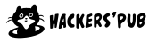

# sukhi が認知している主要な ActivityPub ソフトウェア（掲載用の下書き）

sukhi が認知していて、主な交流が行われるソフトウェアのリストです。

各ロゴは、それぞれのプロジェクトのものです。提携や承認を示すものではありません。

### Mastodon

ロゴ: Mastodon GmbH（商標）。変更せずに使っています。

Thank you for supporting a lot of activity pub communities!

### Misskey

アイコン: Misskey（単色の「Mi」）, [CC BY-SA](https://misskey-hub.net/en/brand-assets/)。

日本のおもしろさを届けてくれてありがとう！

### GoToSocial

ロゴ: Anna Abramek, [CC BY-SA 4.0](https://creativecommons.org/licenses/by-sa/4.0/)。

Thank you for making Go-based activitypub server software! I'm referencing it for minimal implementation for activitypub.

### Bonfire

Thank you for the Circle!

### Hollo

Legend of fedify

### hackers.pub

ロゴ: 박은지, [CC BY-SA 4.0](https://github.com/hackers-pub/visual-identity)。

Great pub in the world of activitypub

### oeee-cafe

OEEE

### Eunha

Thank you for the maintaining ojak!
